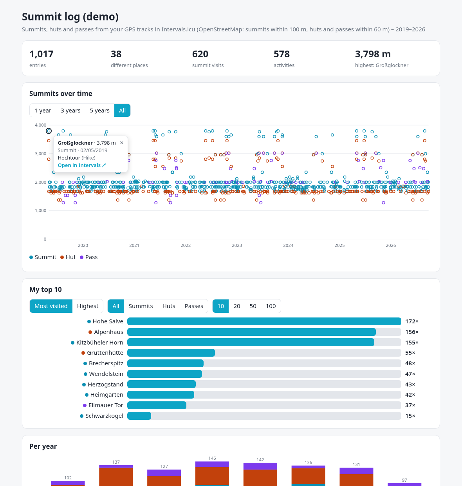
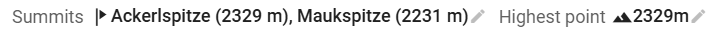
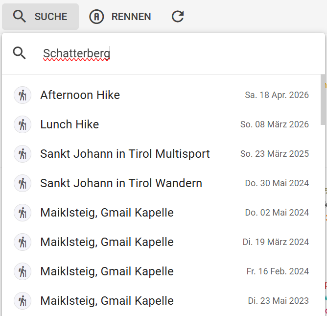
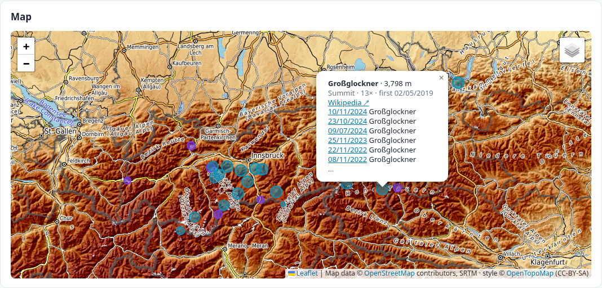
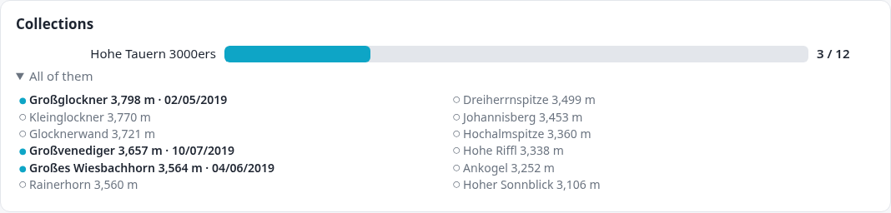

# intervals-summits

[](https://github.com/futureweb/intervals-summits/actions/workflows/tests.yml)
[](LICENSE)

[](https://github.com/futureweb/garmin-intervals-bridge)
[](https://github.com/futureweb/intervals-mcp-server)

**Summits, huts and passes on your [Intervals.icu](https://intervals.icu) activities**, found in your
own GPS tracks with OpenStreetMap, plus your personal **summit log**.



- **In Intervals:** every activity gets its summits in a field, e.g. `Maukspitze (2231 m), Ackerlspitze (2329 m)`.
  Two more fields: the number of summits, which you can chart per week, month or year, and the
  highest point of the activity.
- **The summit log page:**
  - a map of every summit, hut and pass you reached, each with your tours there;
  - your summits, huts and passes over time;
  - your top 10/20/50/100 (most visited or highest);
  - a count per year, with the places that were new that year;
  - collections, e.g. all 3000ers of Tirol, and how many of them you have been on;
  - a searchable log, every entry linked to its activity in Intervals (and to Wikipedia, where
    OpenStreetMap knows the article), first visits starred.
- **Ready-made Intervals charts:** summits per week and per month, with the highest point of each day.
- **It works with every activity that has a GPS track**, whatever it came from: Garmin, Wahoo, Coros,
  Suunto, Polar, a Strava import or an upload. Old ones too: one backfill matches your whole history.
- It needs nothing but your Intervals API key.

**Sister projects** (each works on its own, together they do more):

- [**Garmin Intervals Bridge**](https://github.com/futureweb/garmin-intervals-bridge) puts back what
  Garmin strips from the FIT files it sends to Intervals.icu and syncs the wellness data the official
  sync misses. intervals-summits runs next to it with the same settings, and the bridge tells it when
  there is something new ([how](#next-to-garmin-intervals-bridge-the-bridge-says-when-there-is-something-new)).
- [**Futureweb Intervals MCP**](https://github.com/futureweb/intervals-mcp-server) lets ChatGPT, Claude
  and any MCP client read and analyse your Intervals data. It reads the `Summits` fields like any other,
  so you can ask your assistant which summits you climbed this year, or how often.

## How a summit is found

- **Peaks** (`natural=peak`/`volcano`): the track comes within **100 m**, *and* the track's altitude
  there is at most **80 m below** the summit. A path along the slope below a summit does not count;
  a gondola ride to the top does.
- **Neighbouring summits:** standing on one summit does not count the one next to it. When the track,
  at its closest to a summit, was more than 25 m nearer to another summit it reached, only that one
  counts. Twin summits closer together than that both count.
- **Huts** (`tourism=alpine_hut`/`wilderness_hut`) and **passes** (`mountain_pass=yes`,
  `natural=saddle`): within **60 m**.
- One entry per name and activity, in the order of the track.

These rules were calibrated against an independent summit log of 25 activities: 38 of 40 summits
were found. A summit that OpenStreetMap does not have, or has under another name, cannot be found.
Improve the map, and `recompute` picks it up.

**Stricter or more generous:** the four numbers can be set (`SUMMITS_PEAK_RADIUS`,
`SUMMITS_PEAK_BELOW`, `SUMMITS_HUT_RADIUS`, `SUMMITS_PASS_RADIUS`, see [Settings](#settings)). For example
`SUMMITS_PEAK_RADIUS=50` and `SUMMITS_PEAK_BELOW=30` count only summits you were really on. Best set
them before the first backfill. Changed later, they apply to new activities at once, and
`recompute --from 2010-01-01` applies them to your past (from the stored tracks, without downloading them
again). An activity left with no summit at all keeps the values written before; clear those by hand.

## What lands in Intervals



| Field (code) | Type | Content |
|---|---|---|
| `Summits` | text | `Maukspitze (2231 m), Ackerlspitze (2329 m)`: the summits in the order you reached them |
| `SummitCount` | number, summed per day | how many summits; chart them per week, month or year |
| `HighestPoint` | number, max per day | **only where empty.** Intervals fills it from a FIT file itself; for GPX/TCX and old activities the tool takes the highest point of the track |
| `Huts`, `Passes` | text | huts and passes, in the order you reached them. Off by default: `SUMMITS_FIELDS=…,Huts,Passes` (`HutsPasses`, both in one field as in 0.1, still works) |
| description | one line | optional, `SUMMITS_DESCRIPTION=true`: `⛰️ Summits: Maukspitze (2231 m), …`, **so Intervals' search finds them** (see below). With the huts and passes fields on, they join the line when there were some: `⛰️ Summits: … · Huts: Ackerlhütte (1455 m) · Passes: …` |

The tool creates missing fields itself.
- **Codes are the same for everyone**, so charts and scripts can be shared.
- **Names** are English, or German with `SUMMITS_LANGUAGE=de`. You may rename them in Intervals freely:
  the tool goes by the code.

**Your edits stay.** A value you typed, or another tool wrote, is never overwritten (unless
`--force`). The tool only updates what it wrote itself. In the description it only ever touches its
own line: it reads the description again right before writing, adds the line at the end after a blank
line, and leaves every other character as it is. If the description already names all the summits
(another tool's lines, for example), it adds nothing.

### Seeing them in Intervals

- **On the activity:** the fields show above the charts. Which fields show is chosen per sport, and
  they can go into the summary layout.
- **Filters:** in the activity list and on the totals page, filters can use custom fields, e.g. `SummitCount` at least 1 for all your summit days.
- **Fitness charts:** with writing on, the tool makes two private charts, *Intervals Summits: per
  week* and *per month* (summits per week or month, the highest point of each day), and keeps them up
  to date; `SUMMITS_CHARTS=false` leaves them out, `charts --apply` makes them now. Charts of your own
  are never touched.
- **Search:** Intervals' search looks at names and descriptions, not at custom fields. Turn on
  `SUMMITS_DESCRIPTION=true`, and searching a summit finds every activity that reached it, also
  where it is not in the name:

  

## Installing and running

### Docker (NAS, server, next to the bridge)

```bash
curl -O https://raw.githubusercontent.com/futureweb/intervals-summits/main/compose.yaml
curl -o .env https://raw.githubusercontent.com/futureweb/intervals-summits/main/.env.example   # put your key in
docker compose up -d                  # a dry run: the summit log fills, nothing is written
docker compose logs -f                # what it would write
docker compose run --rm summits backfill --from 2015-01-01 --apply      # your past
# then command: ["run", "--apply", "--ui", "--host", "0.0.0.0"] in compose.yaml and up -d again
```

The summit log is at **http://localhost:8766/**. Next to the bridge, add the service to the bridge's
`compose.yaml` and use its `.env`: the same key works.

### Home Assistant

Add `https://github.com/futureweb/intervals-summits` as an app repository (Settings → Apps → App store
→ ⋮ → Repositories). Then install **Intervals Summits**, enter your Intervals API key, optionally
"Backfill from", and start it. The summit log appears in the sidebar. Switch on *Write to Intervals*
once the dry run looks right.

### On your computer (Windows, Mac, Linux), Python 3.12+

```bash
pip install intervals-summits              # Windows: py -m pip install intervals-summits
intervals-summits backfill --from 2015-01-01          # dry run over your past
intervals-summits backfill --from 2015-01-01 --apply  # … and write
intervals-summits run --apply --ui         # keep running; the summit log on http://127.0.0.1:8766/
```

Settings come from the environment, else from `./.env`, `~/IntervalsSummits/.env` or the bridge's
`~/GarminBridge/.env`. A bridge set up on the same computer is enough: nothing to configure twice.
Instead of keeping it running, `intervals-summits sync --apply` once a day (Task Scheduler, cron)
works as well. It catches up on the days since its last run.

### Next to garmin-intervals-bridge: the bridge says when there is something new

The bridge looks for new activities in Intervals every few minutes anyway, whatever their source. From
version 0.12.9 on it passes that on: set `BRIDGE_NOTIFY_URL` in the bridge's settings, and summits
syncs right after the bridge instead of looking every 15 minutes itself. On its own it then looks only
every 3 hours, in case the bridge stops. This needs `run --ui`, as in the Docker and Home Assistant
setups.

| The bridge runs … | `BRIDGE_NOTIFY_URL` |
|---|---|
| on the same computer | `http://127.0.0.1:8766/sync` |
| in the same `compose.yaml` | `http://summits:8766/sync` |
| as a Home Assistant app | `http://<hostname>:8766/sync`, the hostname is on the *Info* tab of the Intervals Summits app |

`POST /sync` only says "something is new": it takes no data, and summits keeps it to one sync a
minute. The bridge's notes about new wellness data (0.12.10+, `"event": "wellness"`) are taken and
left alone, so one `BRIDGE_NOTIFY_URL` list can serve summits and your own tools. `intervals-summits status` shows the bridge's last note. On a Linux server with systemd,
[`deploy/intervals-summits-run.service`](deploy/intervals-summits-run.service) keeps it running
(instead of the timer in `deploy/`).

### Commands

| Command | |
|---|---|
| `sync [--apply] [--force]` | The recent days; after a pause it reads back to the last run (at most 14 days) |
| `backfill --from DATE [--to DATE] [--apply]` | The past: tracks first, then OpenStreetMap for all of them at once, then matching and writing. Resumable. |
| `recompute --from DATE [--apply]` | Match again, e.g. after OpenStreetMap got better. Writes only differences. |
| `run [--apply] [--ui] [--host H] [--port 8766]` | Keeps running: a sync every 15 minutes (every 3 hours while the bridge reports new activities), optionally with the summit log page |
| `ui [--host H] [--port 8766]` | Only the summit log page |
| `page [--out FILE] [--language de]` | The summit log as one self-contained HTML file, to keep or share |
| `status [--check] [--fields]` | Counts and the last sync; `--check` for health checks (exit 1 when no sync came for long) |
| `fields [--apply]` | Create the activity fields now |
| `charts [--apply]` | Create or update the two Intervals charts now (otherwise done with the daily field check) |

Without `--apply`, nothing is written to Intervals. The summit log page still fills.

`python examples/demo.py demo.html` builds a summit log with made-up data (the screenshot above).

### The map and collections



The map needs the internet: it loads [Leaflet](https://leafletjs.com) and the map tiles once you
scroll to it; everything else on the page works offline. The tiles come from
[OpenTopoMap](https://opentopomap.org) (`SUMMITS_MAP_TILES` for another server, `off` for no map).

A **collection** is every named summit of an area, above a height if you like:
`SUMMITS_COLLECTIONS="Tirol 3000ers=r52343>=3000; Kaisergebirge=r2115422"`. The area is its name in
OpenStreetMap, or `r<relation id>` when a name is ambiguous (find the id on openstreetmap.org). Each
collection is read once (one Overpass query) and again after half a year; the page shows how many of
its summits you have been on, and the map the ones still missing.



### The page on a web server

`SUMMITS_PAGE_FILE=/var/www/example/summits/index.html` writes the page there after every sync
instead of into the data folder, readable by the web server; protect the folder (basic auth, say), it
shows where you go. `SUMMITS_PAGE_LANGUAGE=de` gives the page its own language when the fields keep
another.

## Settings

| Variable | Default | |
|---|---|---|
| `INTERVALS_API_KEY` | – | Intervals → Settings → Developer Settings |
| `INTERVALS_ATHLETE_ID` | `0` | `0` = the key's owner |
| `SUMMITS_DATA_DIR` | `~/GarminBridge/summits` next to a bridge, else `~/IntervalsSummits` | database, tracks, `summits.html` |
| `SUMMITS_LANGUAGE` | `en` | `en` or `de`: names of new fields, the page, the description line |
| `SUMMITS_NAME_LANGUAGE` | – | e.g. `en`: OpenStreetMap's `name:en` where there is one, else the local name |
| `SUMMITS_FIELDS` | `Summits,SummitCount,HighestPoint` | add `Huts,Passes` for huts and passes (fields and description line) |
| `SUMMITS_DESCRIPTION` | `false` | `true`: the `⛰️ Summits:` line in the description (searchable) |
| `SUMMITS_TYPES` | every outdoor type | only these activity types, e.g. `Hike,BackcountrySki` |
| `SUMMITS_PEAK_RADIUS` | `100` | metres (10–200): how close the track must come to a summit |
| `SUMMITS_PEAK_BELOW` | `80` | metres (0–500): how far below the summit the track may be there |
| `SUMMITS_HUT_RADIUS` | `60` | metres (10–200) for huts |
| `SUMMITS_PASS_RADIUS` | `60` | metres (10–200) for passes |
| `SUMMITS_LOOKBACK_DAYS` | `3` | how far `sync` looks back |
| `SUMMITS_INTERVAL_MINUTES` | `15` | `run`: minutes between syncs |
| `SUMMITS_KEEP_TRACKS` | `true` | keep the tracks: `recompute` without downloading them again (~20 KB per activity) |
| `SUMMITS_OVERPASS_URL` | overpass-api.de | another Overpass server |
| `SUMMITS_PAGE_TITLE` | Summit log / Gipfelbuch | |
| `SUMMITS_PAGE_FILE` | `summits.html` in the data folder | where the page goes, e.g. a web server's folder |
| `SUMMITS_PAGE_LANGUAGE` | `SUMMITS_LANGUAGE` | `en` or `de` for the page alone |
| `SUMMITS_MAP_TILES`, `SUMMITS_MAP_ATTRIBUTION` | OpenTopoMap | another tile server (`https://…/{z}/{x}/{y}.png`) and its credit line; `off`: no map |
| `SUMMITS_COLLECTIONS` | – | `Label=Area>=height; …`, see [The map and collections](#the-map-and-collections) |
| `SUMMITS_CHARTS` | `true` | `false`: no Intervals charts |

## Fair to Intervals and OpenStreetMap

- **Intervals:** the API key is usually shared with the bridge. The tool paces itself (at most
  about 1.5 requests a second) and waits whenever Intervals answers 429. A sync with nothing new is
  one small request.
- **OpenStreetMap:** points come from the Overpass API and are cached in 0.2° cells for 180 days,
  so your usual tours cost no query after the first time. A backfill asks for whole regions at
  once (16 years and 1,800 tours, in the Alps and on a few trips abroad: 18 queries). One query at a time, with a pause between
  queries, and patience on 429/5xx.

## Privacy

Your data stays on your computer and in your Intervals account. Overpass learns which 0.2° cells
(about 22 × 15 km) you need, and the areas of your collections, never a track or an activity. When
you open the map, your browser loads Leaflet from cdnjs and the tiles of the part you look at from
the tile server. Details: [PRIVACY.md](PRIVACY.md).

## Licence

MIT. Map data © [OpenStreetMap](https://www.openstreetmap.org/copyright) contributors, ODbL.
